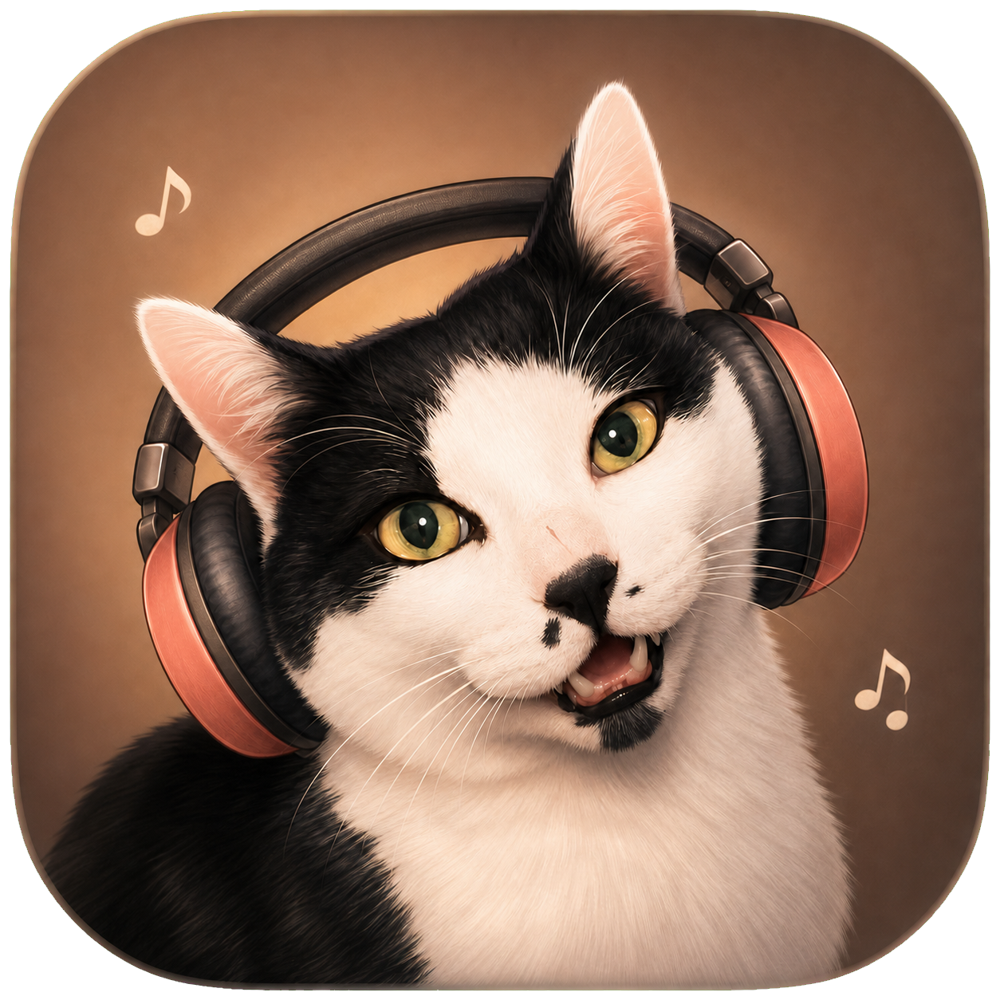

# 嗷嗷状态栏歌词



一个极简的 macOS Apple Music 状态栏歌词工具。它会自动读取当前歌曲和播放进度，匹配同步歌词，并将当前歌词直接显示在 macOS 状态栏中。

## 功能

- 自动识别 Apple Music 当前歌曲
- 状态栏逐行同步显示歌词
- 精确匹配失败时，按歌名、歌手和时长自动寻找最合适的歌词
- 暂停、停止和换歌状态自动响应
- Apple Music 退出后，歌词应用自动退出
- 无 Dock 图标，不打扰桌面

## 安装教程

1. 在 GitHub 的 **Releases** 页面下载最新版 `嗷嗷状态栏歌词-*.dmg`。
2. 双击打开 DMG。
3. 把“嗷嗷状态栏歌词”拖入旁边的“应用程序”文件夹。
4. 打开 Apple Music 并开始播放歌曲。
5. 前往“应用程序”，打开“嗷嗷状态栏歌词”。

本应用暂未经过 Apple 公证。首次打开如果提示无法验证开发者：

1. 在 Finder 的“应用程序”中找到“嗷嗷状态栏歌词”。
2. 按住 Control 点击应用，选择“打开”。
3. 在弹出的对话框中再次选择“打开”。

也可以前往“系统设置 → 隐私与安全性”，在页面下方选择“仍要打开”。

## 首次授权

第一次运行时，macOS 会询问是否允许应用控制“音乐”，请选择“允许”。这是读取歌曲名称、歌手、专辑和播放进度所必需的。

如果误点了拒绝：

1. 打开“系统设置 → 隐私与安全性 → 自动化”。
2. 找到“嗷嗷状态栏歌词”。
3. 打开它对“音乐”的访问权限，然后重新启动应用。

## 使用方法

- 歌词会出现在屏幕顶部状态栏。
- 点击歌词，可查看当前歌曲信息或退出应用。
- 按住 Command 拖动歌词，可以调整它在状态栏中的位置。
- 切歌后会自动重新匹配歌词。
- 退出 Apple Music 后，歌词应用也会自动退出。

歌词匹配需要网络连接。少数歌曲可能没有同步歌词；应用会显示歌曲名称并继续等待下一首歌。

## 卸载

1. 退出“嗷嗷状态栏歌词”。
2. 在“应用程序”文件夹中将它移到废纸篓。

如果还要清除自动化权限，可在“系统设置 → 隐私与安全性 → 自动化”中关闭对应权限。

## 从源码构建

需要 macOS 13 或更高版本及 Apple Command Line Tools：

```sh
git clone https://github.com/sange1022/aow-statusbar-lyrics.git
cd aow-statusbar-lyrics
./build.sh
```

生成的应用位于 `build/嗷嗷状态栏歌词.app`。制作 DMG：

```sh
./make-dmg.sh
```

## 歌词来源

歌词数据由 [LRCLIB](https://lrclib.net) 提供。匹配时仅发送当前歌曲的名称、歌手、专辑和时长；不会读取或上传 Apple Music 账户信息。
